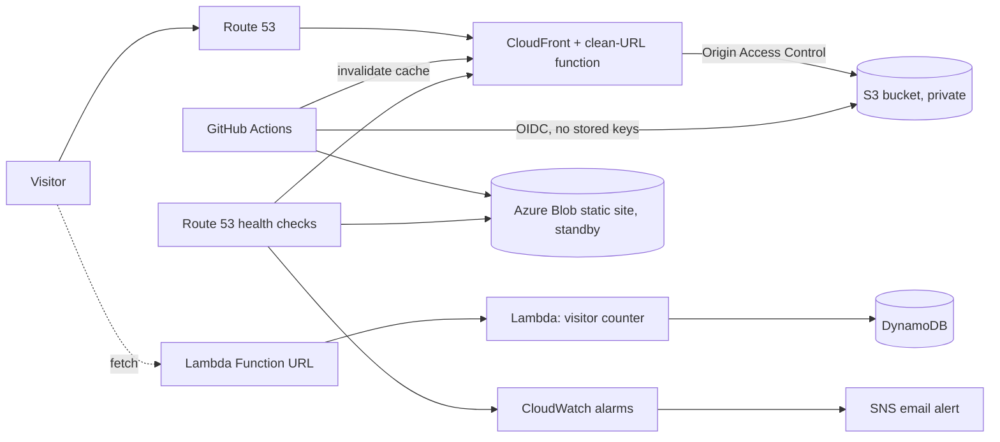

# Multi-cloud portfolio infrastructure

Infrastructure as code for [samuelojo.tech](https://samuelojo.tech): a static portfolio served from **AWS** (primary) with an **Azure** standby copy, health monitoring on both, and a serverless visitor counter. Everything here is Terraform.


## Architecture



## What gets built

| File | Resources |
|---|---|
| `infra/aws.tf` | Private S3 bucket (versioned, encrypted), CloudFront distribution with Origin Access Control, security headers and HTTP/3, a CloudFront Function for clean URLs and redirects, custom domain via an existing ACM certificate and Route 53 zone |
| `infra/azure.tf` | Resource group and a storage account with static website hosting (the standby copy) |
| `infra/dns.tf` | Route 53 health checks on both sites, CloudWatch alarms, SNS topic for email alerts |
| `infra/counter.tf` | DynamoDB table, Python Lambda with a public Function URL (CORS locked to the site), least-privilege IAM role |
| `infra/bootstrap/` | One-off stack that creates the S3 bucket and DynamoDB table for remote Terraform state and locking |

## How it fits together

- **Private origin.** The S3 bucket blocks all public access. Only CloudFront can read it, using Origin Access Control with SigV4 signing.
- **Keyless deploys.** The site pipeline authenticates to AWS with GitHub OIDC, so no AWS access keys are stored anywhere.
- **Remote state.** State lives in a versioned, encrypted S3 bucket with DynamoDB locking, so runs can't corrupt each other.
- **Atomic counter.** The Lambda increments DynamoDB with a single `ADD` update, so concurrent visitors can't race.
- **Monitoring.** Route 53 checks both clouds every 30 seconds. An outage raises a CloudWatch alarm and emails you through SNS.

## Deploying

```bash
# 1. One-off: create the remote state bucket and lock table
cd infra/bootstrap
terraform init && terraform apply

# 2. Main stack (needs AWS and Azure CLI logins)
cd ..
terraform init
terraform plan
terraform apply -var="alert_email=you@example.com"   # alert_email is optional
```

Prerequisites: an existing Route 53 hosted zone and an issued ACM certificate (in `us-east-1`) for the domain, and an Azure subscription. Edit `infra/variables.tf` for your domain, and the bucket names in `infra/main.tf` and `infra/aws.tf`, which must be globally unique.

## Notes and limits

- Azure is a **standby**, not automatic failover. Azure static sites can't serve HTTPS on a custom domain without Front Door (about $35 a month), so the health checks and alarms tell me if either side fails, and I switch over by hand.
- The Lambda has no reserved concurrency because new AWS accounts have a low account limit.
- Terraform is applied from the CLI. CI (`.github/workflows/validate.yml`) checks formatting and validity on every push.

The website itself (HTML, CSS, JS and media) is deployed by a separate pipeline.
